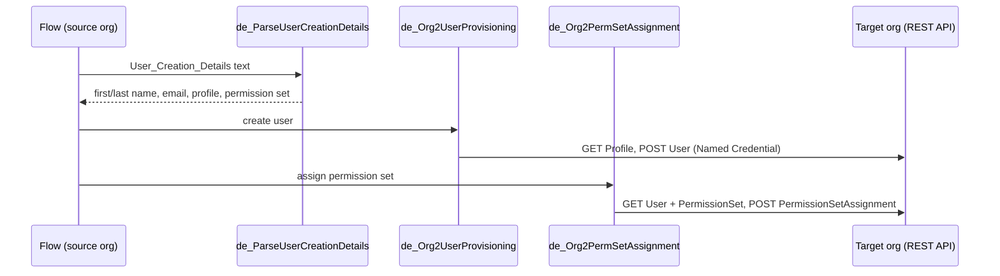

# Org Bridge

Provision a user in a **different Salesforce org** straight from a Flow: create the User and assign permission sets in the target org via REST callouts through a Named Credential.

## What it does

Three invocable Apex actions you drop into a Flow in the source org:

| Action (class) | Purpose |
|---|---|
| `Parse User Creation Details` (`de_ParseUserCreationDetails`) | Parses a free-text block (`First Name - ...`, `Last Name - ...`, `Email - ...`, `Profile Name - ...`, `Username - ...`, `Permission Set Name - ...`), e.g. from a Service Request text field |
| `Create User In Target Org` (`de_Org2UserProvisioning`) | Resolves the Profile Id by name in the target org, then `POST`s a User; returns the new user Id |
| `Assign Permission Set In Target Org` (`de_Org2PermSetAssignment`) | Resolves the user by username and the permission set by API name, then creates a `PermissionSetAssignment` |

All callouts use `callout:Target_Org_NC/...`, so no credentials or org URLs live in code. Unit tests mock the HTTP layer.

## Architecture



## Prerequisites

- Salesforce CLI; two orgs (source with the Flow, target where users are created).
- In the **target** org: a Connected App / External Client App with OAuth scopes for API access, and an integration user allowed to create Users and assign permission sets.

## Setup and deploy

```bash
sf project deploy start --source-dir force-app --target-org <source-alias>
```

## Configuration

Create the Named Credential `Target_Org_NC` in the source org (Setup > Named Credentials) pointing at the target org. A template with placeholders is in `docs/named-credential-template/`; create the External Credential (OAuth 2.0) and a principal, then grant the permission set access to it. To use another name, change `NAMED_CREDENTIAL` in the two service classes and tests.

Try it without a Flow using the anonymous Apex scripts (fill the placeholders):

```bash
sf apex run --file scripts/apex/createTargetUser.apex --target-org <source-alias>
sf apex run --file scripts/apex/assignTargetPermSet.apex --target-org <source-alias>
```

Notes: the API version in the REST paths is `v66.0`; default time zone/locale are `America/Los_Angeles` / `en_US` unless supplied.

## Screenshots

Add screenshots to `docs/screenshots/`.

## License

MIT, see [LICENSE](LICENSE).
